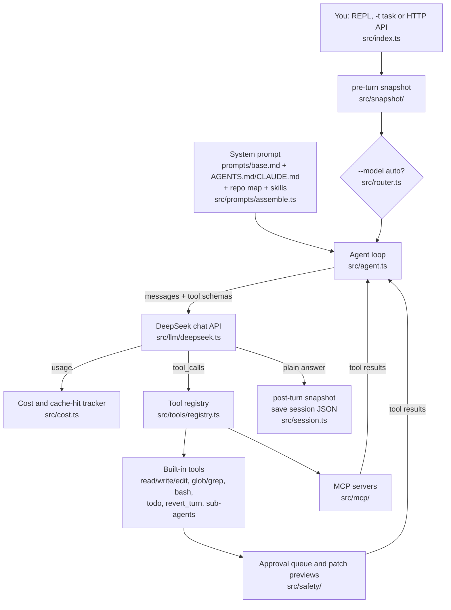

# WEIPING_WHALE

A small terminal coding agent for DeepSeek models: it reads your repository, runs
commands after asking, proposes edits as patches you apply, and checkpoints the
workspace around every turn so any turn can be undone.

It is a TypeScript port of the design of
**[CodeWhale](https://github.com/codewhale-hq/Codewhale)** (formerly `deepseek-tui`,
MIT), a much larger and more mature Rust agent. The snapshot scheme, session
fork/backtrack, cost footer, auto-routing and prompt layout all come from CodeWhale;
see [THIRD_PARTY_NOTICES.md](THIRD_PARTY_NOTICES.md). Not affiliated with DeepSeek.

```text
$ npm run demo          # build output and startup banner left out
session: demo
path: ~/.weiping-whale/sessions/demo.json
━━ test.mjs fails, find the bug and fix it
thinking...
tool execute_bash {"command":"node test.mjs"}
  execute_bash failed in 3471ms
thinking round 2...
tool read_file {"path":"src/slugify.mjs"}
  read_file done in 12ms
thinking round 3...
tool edit_file {"path":"src/slugify.mjs","old_string":"    .replace(/[^a-z0-9]+/g, \"-\");","new_string":"    .replace(/[^a-z0-9]+/g...
  edit_file done in 174ms
thinking round 4...

WEIPING_WHALE
`node test.mjs` fails because slugify("Hello, World!") returns "hello-world-".
The regex turns every run of non-alphanumerics into a dash, including the
trailing "!", and nothing trims dashes at the ends.

I prepared patch 6f52149d, which strips leading and trailing dashes.
Review it with /patches, then /apply 6f52149d.

└ $0.0004 · 6.5k tok · cache 71%
━━ /apply 6f52149d
Applied patch 6f52149d to ~/slugify-demo/src/slugify.mjs
━━ run the tests again
thinking...
tool execute_bash {"command":"node test.mjs"}
  execute_bash done in 2452ms
thinking round 2...

WEIPING_WHALE
Ran `node test.mjs`: 2 tests passed

└ $0.0005 · 10.4k tok · cache 80%
━━ /snapshots
4e7b557da997  2026-10-22 04:59:01  post-turn:2
ecaf8c885847  2026-10-22 04:58:55  pre-turn:2
7f520501f32a  2026-10-22 04:58:51  post-turn:1
507aabc12156  2026-10-22 04:58:42  pre-turn:1
```

That session is real except for the model. `npm run demo` starts
[`scripts/mock-deepseek.mjs`](scripts/mock-deepseek.mjs), a fake DeepSeek endpoint
whose replies are scripted, and points the built CLI at it. The shell command, the
file read, the patch preview, the snapshots and the session file are produced by the
actual tool code; the token counts are the mock's rough estimate (4 characters per
token) priced at the default flash rates. The same session as an image is in
[docs/demo.png](docs/demo.png).

## Why I built it

I wanted to understand how tools like Claude Code, Codex and CodeWhale work, not just
use them. Porting CodeWhale to a language I read every day, at a size I can hold in my
head, was the most direct way. If you just want a coding agent, use CodeWhale itself
(OS sandboxing, more language servers, more providers), [Aider](https://github.com/Aider-AI/aider),
or one of the vendor CLIs. This repo is for reading and changing the loop.

## Install

Requires Node.js 22.18 or newer and git. The package is not published on npm.

```bash
git clone https://github.com/appleweiping/WEIPING_WHALE.git
cd WEIPING_WHALE
npm ci
npm run demo            # builds, then replays the session above; no API key needed
npm link                # puts `wwhale` and `weiping-whale` on your PATH
```

With a DeepSeek key:

```bash
export DEEPSEEK_API_KEY=sk-...
wwhale --doctor         # checks config, key source and paths
wwhale                  # REPL in the current directory
wwhale -t "summarize the architecture of this repo"
```

Inside the REPL, `/patches` and `/apply <id>` review edits, `/approve <id>` runs a held
shell command, `/undo` rolls the workspace back one turn, and `/cost` shows spend.
The full list of commands, config keys and safety profiles is in
[docs/usage.md](docs/usage.md).

## How a coding agent works in ~8.5k lines

`src/` is about 8,500 lines of TypeScript (`wc -l src/*.ts src/*/*.ts`). One turn
looks like this:



1. **Prompt.** [`src/prompts/assemble.ts`](src/prompts/assemble.ts) builds one system
   message, most static part first so DeepSeek's prefix cache keeps hitting:
   [`prompts/base.md`](prompts/base.md), the project's `AGENTS.md`/`CLAUDE.md`, a
   size-limited map of tracked files and their top-level symbols
   ([`src/context/repo-map.ts`](src/context/repo-map.ts)), and the list of skills.
2. **Checkpoint.** Before the turn, [`src/snapshot/repo.ts`](src/snapshot/repo.ts)
   commits the whole workspace into a separate git repository under
   `~/.weiping-whale/snapshots/`, passing `--git-dir` and `--work-tree` explicitly so
   your own `.git` is never touched. `/undo` checks that tree back out.
3. **Routing.** With `--model auto`, [`src/router.ts`](src/router.ts) picks flash or
   pro and the thinking level from keywords in your message. No extra API call.
4. **The loop.** [`Agent.complete()`](src/agent.ts) sends the messages plus every tool
   schema, executes each returned tool call, appends the results and asks again,
   until the model answers without tool calls or `max_iterations` is reached. The
   loop and its tool dispatcher are about 80 lines; most of the code is the tools
   and bookkeeping around it.
5. **Tools and safety.** Built-in tools live in [`src/tools/`](src/tools/). Shell
   commands are matched against two regex lists in
   [`src/safety/approval.ts`](src/safety/approval.ts): broad recursive deletes, disk
   and shutdown commands are always blocked; deletes, moves, redirections, package
   installs, force-pushes and `ssh` wait for `/approve`; everything else runs. In the
   default mode `edit_file` and `write_file` only create a preview
   ([`src/safety/patches.ts`](src/safety/patches.ts)) until you `/apply` it. MCP
   tools come from the official SDK client in [`src/mcp/client.ts`](src/mcp/client.ts)
   and are namespaced per server.
6. **Cost.** Every response's `usage` goes to [`src/cost.ts`](src/cost.ts), which
   prices cache-hit and cache-miss input tokens separately; the footer turns yellow
   or red when the cache-hit ratio drops, which usually means the context was
   reshuffled.
7. **Sessions.** After the turn the message list is saved as JSON
   ([`src/session.ts`](src/session.ts)). `/fork` copies it into a new session,
   `/backtrack n` cuts it just before the n-th last user message, and `/compact`
   ([`src/compaction.ts`](src/compaction.ts)) folds old messages into a summary while
   keeping tool calls paired with their results.
8. **Sub-agents.** `agent_open` starts another `Agent` with a copy of the config
   ([`src/tools/subagent.ts`](src/tools/subagent.ts)); the pool and nesting depth are
   capped.

The terminal UI ([`src/ui/terminal.ts`](src/ui/terminal.ts)), LSP diagnostics after
edits ([`src/lsp/`](src/lsp/)) and the optional `--serve` HTTP/SSE API
([`src/server/runtime-api.ts`](src/server/runtime-api.ts)) sit around this core.

## Tests

```bash
npm run typecheck
npm test
```

`npm test` builds the CLI and runs 18 end-to-end scripts in [`scripts/`](scripts/)
(snapshots, sessions, cost, compaction, routing, MCP against a fake server, the HTTP
API, the full agent loop against the mock model, and more), then packs the tarball,
installs it in a temp directory and runs both binaries. Nothing calls the real
DeepSeek API. CI runs the same on Ubuntu and Windows.

## Limitations

- Shell safety is approval prompts plus pattern matching, not an OS sandbox. A
  command you approve runs with your permissions.
- The client targets DeepSeek's OpenAI-compatible chat API; other endpoints set via
  `base_url` are untested. The default prices in `src/cost.ts` will drift; override
  them with `[pricing]` in the config.
- LSP diagnostics cover TypeScript/JavaScript and Python, and only if the language
  servers are installed.
- The demo and tests prove the plumbing, not the quality of the model's edits.

## License

MIT, see [LICENSE](LICENSE). CodeWhale's MIT notice is in
[THIRD_PARTY_NOTICES.md](THIRD_PARTY_NOTICES.md).
